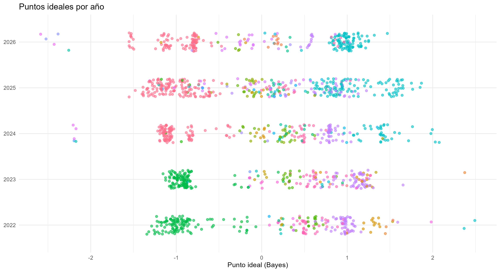
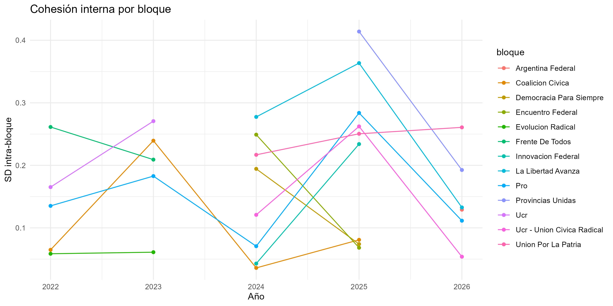
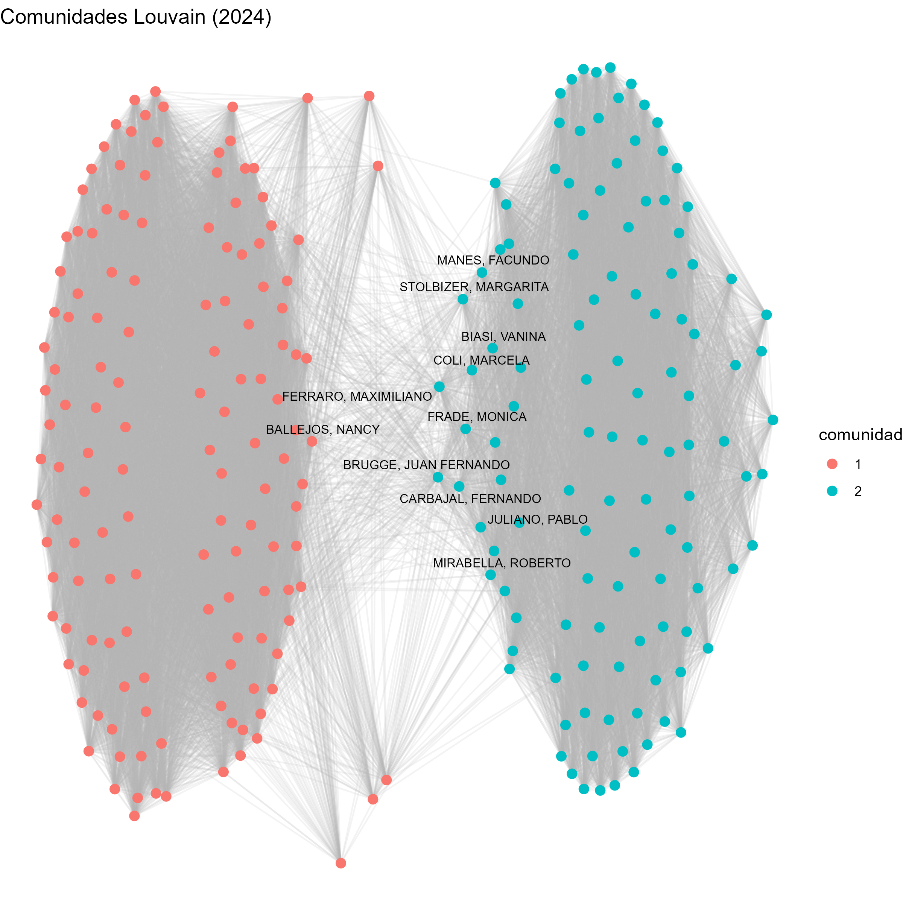
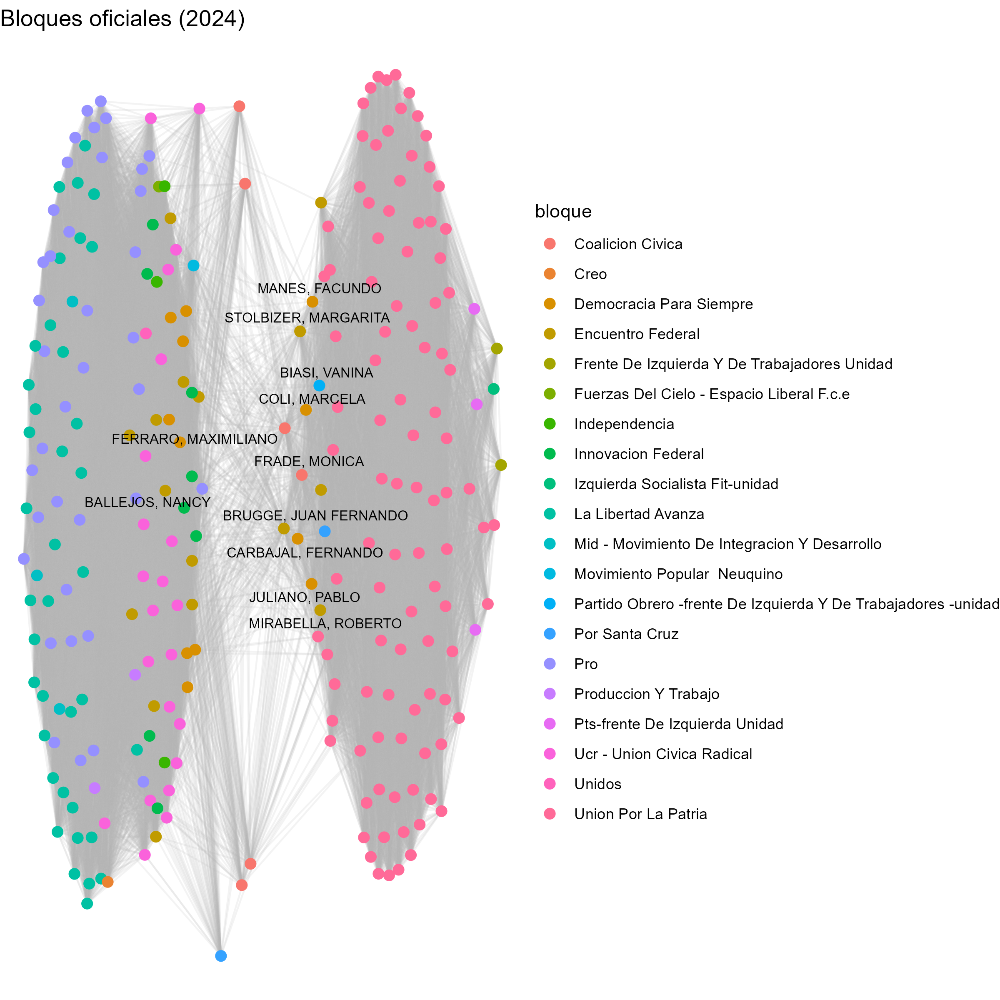
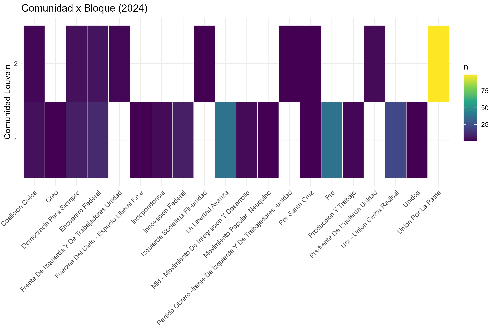
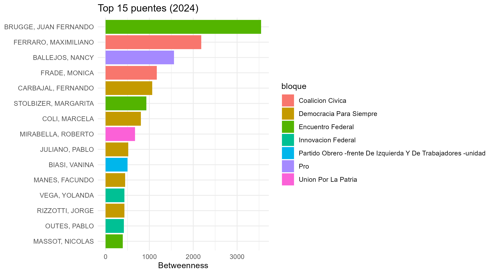
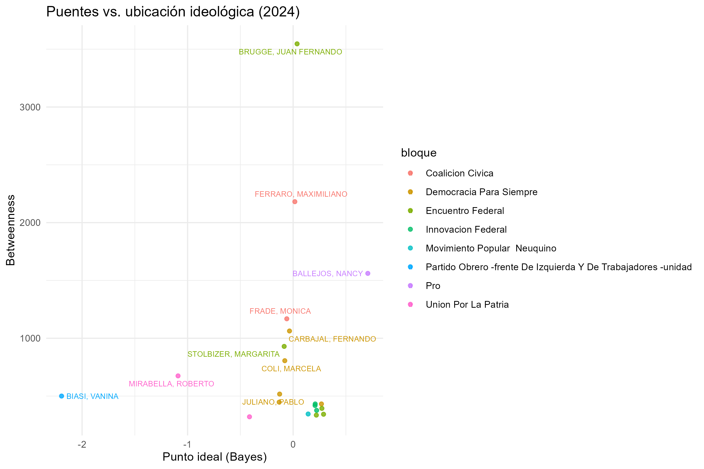

```{r}
#| include: false

library(tidyverse)
library(igraph)
library(tidygraph)
library(ggraph)
library(ggrepel)
library(scales)
library(pheatmap)

datos     <- readRDS("output/datos.rds")
redes     <- readRDS("output/redes.rds")
g2024     <- readRDS("output/g2024.rds")
cent      <- readRDS("output/cent.rds")
tabla_com <- readRDS("output/tabla_com.rds")
```
## Motivación

- ¿Cómo se ubican los bloques en el eje ideológico entre 2022 y 2026?
- ¿Los bloques son cohesionados o hay fisuras internas?
- ¿La red de coincidencias de voto reproduce los bloques oficiales?
- ¿Quiénes son los "puentes" entre comunidades?

::: {.notes}
Presentar el objetivo en 30 segundos. Mencionar que se usan dos fuentes: puntos ideales estimados (PCA y Bayes) y votaciones nominales.
:::

## Datos y metodología

::: {.columns}
::: {.column width="50%"}
**Fuentes**
- `idps.csv`: punto ideal por legislador-año (`idp_pca`, `idp_bayes`, `sd_bayes`).
- `legisladores_bloque_provincia.csv`: bloque y provincia.
- `sesiones_dt.csv`: votaciones nominales (legislador × votación × voto).
:::

::: {.column width="50%"}
**Métodos**
- Estandarización del punto ideal por año.
- Distancias euclídeas intra/inter bloque.
- Coincidencia de votos vía índice de **Jaccard** (solo AFIRMATIVO/NEGATIVO).
- Detección de comunidades con **Louvain**.
- Centralidad: degree y betweenness.
:::
:::

## Puntos ideales por año

```{r}
#| echo: false
#| fig-width: 11
#| fig-height: 6
#| fig-align: center


```

::: {.notes}
Comentar el eje: en Argentina el primer componente suele capturar oficialismo vs. oposición más que izquierda-derecha pura. Señalar los extremos (LLA, UP) y los bloques provinciales en el centro.
:::

## Cohesión interna por bloque

```{r}
#| echo: false
#| fig-width: 10
#| fig-height: 5
#| fig-align: center


```

::: {.notes}
Menor SD intra-bloque = mayor cohesión. Comparar la evolución 2022→2026. Mencionar qué bloques se fracturan y cuáles se consolidan.
:::

## Red de coincidencia 2024: comunidades vs. bloques

::: {.columns}
::: {.column width="50%"}
```{r}
#| echo: false
#| fig-width: 6
#| fig-height: 6
#| fig-align: center


```

*Comunidades Louvain*
:::

::: {.column width="50%"}
```{r}
#| echo: false
#| fig-width: 6
#| fig-height: 6
#| fig-align: center


```

*Bloques oficiales*
:::
:::

::: {.notes}
Comparar las dos coloraciones. Si coinciden 1 a 1, disciplina alta. Si hay mezcla, hay puentes o disidencias.
:::

## ¿La red reproduce los bloques?

```{r}
#| echo: false
#| fig-width: 10
#| fig-height: 6
#| fig-align: center


```

::: {.notes}
Leer la tabla: comunidad 1 ≈ LLA+PRO, comunidad 2 ≈ UP, etc. Identificar los bloques que se reparten entre dos comunidades (fisuras internas).
:::

## Top puentes entre comunidades

```{r}
#| echo: false
#| fig-width: 10
#| fig-height: 6
#| fig-align: center


```

::: {.notes}
Interpretación: between alto + idp_bayes central = moderado bisagra; between alto + idp_bayes extremo = disidente o líder de bloque chico.
:::

## Puentes vs. ubicación ideológica

```{r}
#| echo: false
#| fig-width: 10
#| fig-height: 6
#| fig-align: center


```

::: {.notes}
Mostrar si los puentes están en el centro ideológico o en los extremos. Es la slide más "de tesis": conecta red con puntos ideales.
:::

## Hallazgos principales

1. **Eje claro**: el punto ideal separa oficialismo de oposición; los bloques provinciales ocupan el centro.
2. **Cohesión heterogénea**: UP y LLA son cohesionados; los bloques medianos muestran mayor dispersión.
3. **La red reproduce los bloques**, con excepciones puntuales que funcionan como puentes.
4. **Los puentes no son los más extremos**: la moderación ideológica se asocia con mayor centralidad de intermediación.

::: {.notes}
Cerrar con los 3–4 mensajes que querés que se lleven. No leer la lista: contarla.
:::

## Limitaciones

- El eje PCA cambia de escala entre años; se estandarizó por año pero no es perfectamente comparable.
- La `sd_bayes` alta indica legisladores poco identificados.
- La red mide **coincidencia**, no causalidad ni acuerdo político explícito.
- Louvain es estocástico: correr con semilla fija para reproducibilidad.

## Gracias

::: {.columns}
::: {.column width="60%"}
**¿Preguntas?**

Contacto: `tu.email@ejemplo.com`

Repositorio: `github.com/tu-usuario/analisis-votaciones`
:::

::: {.column width="40%"}
```{r}
#| echo: false
#| fig-width: 4
#| fig-height: 4
#| fig-align: center


```
:::
:::

::: {.notes}
Dejar la slide final visible durante las preguntas.
:::
---

## Quarto

Quarto enables you to weave together content and executable code into a finished presentation. To learn more about Quarto presentations see <https://quarto.org/docs/presentations/>.

## Bullets

When you click the **Render** button a document will be generated that includes:

- Content authored with markdown
- Output from executable code

## Code

When you click the **Render** button a presentation will be generated that includes both content and the output of embedded code. You can embed code like this:

```{r}
1 + 1
```
